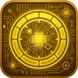
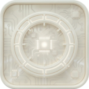
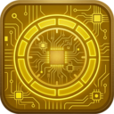
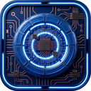

<!-- SPDX-License-Identifier: GPL-3.0-or-later -->

[](https://github.com/RobertoTorino/bc250-bazzite-suite/actions/workflows/ci.yml)

# BC250 Bazzite Suite

Tools for the AMD BC-250 running Bazzite, in one repository. The **[portal](portal)** installs, opens, updates
and removes them: BC-250 Bazzite Test is always installed, every other app is optional.

## Install

**Install the portal, not the apps one by one.** It installs, updates and removes every app below for you, and
checks each download against its checksum.

1. Open the **[latest portal release](https://github.com/RobertoTorino/bc250-bazzite-suite/releases/latest)** and
   download `portal-v<version>.tar.gz` and `SHA256SUMS`.
2. In a terminal, in the folder you downloaded them to:

   ```bash
   sha256sum --check --ignore-missing SHA256SUMS
   tar -xzf portal-v*.tar.gz && cd portal-v*/ && ./install.sh
   ```

3. Start **BC250 Bazzite Suite** from the app menu or the Desktop, and install the apps you want from there.

The other releases on the Releases page (`governor-v…`, `helixsr-v…` and so on) are the app downloads the portal
uses. You do not need them.

## The apps

-  **[BC-250 Bazzite Test](apps/bazzite-test)**: Read-only diagnostics, stress test and benchmarks. Always installed.
-  **[BC-250 GPU Governor Manager](apps/governor)**: Manage the cyan-skillfish GPU governor: tuning, safe points, profiles, backups.
-  **[BC-250 CU Bisect](apps/cu-bisect)**: Tell bad CUs apart from an unstable CU unlock, and apply a tested unlock.
-  **[BC-250 Cores Bisect](apps/cores-bisect)**: Tell bad CPU cores apart from an unstable core unlock, before you persist the 8C/16T unlock.
-  **[BC-250 GPU OC Bisect](apps/gpu-oc-bisect)**: Find your board's safe GPU overclock and undervolt, one step at a time.
-  **[BC-250 Persistent ACPI](apps/persistent-acpi)**: CPU C-states and frequency scaling through a persistent ACPI override (GRUB early initrd).
-  **[BC-250 System Overlay](apps/system-overlay)**: CPU, GPU, refresh rate, fan and temperatures in a small window that stays on top.
-  **[BC-250 BIOS Reader](apps/bios-reader)**: The BIOS settings as the setup screen shows them, hidden menus included. Stock or modded BIOS. Read-only.
-  **[BC-250 Memory Manager](apps/memory-manager)**: The VRAM split in CMOS, with the GTT, TTM limit and swap layout that go with it.
-  **[BC-250 ACE Queues](apps/ace-queues)**: Async compute for games: a patched RADV beside the system Mesa, built on the board and tested before use.
-  **[BC250 HDMI CEC](apps/hdmi-cec)**: Turn the TV on and off with the board, switch its input and use its remote, over HDMI-CEC.
-  **[BC250 Bazzite SFTP Tools](apps/sftp-tools)**: Move files between computers over SFTP, and manage the SSH server of a Bazzite host.

**Gaming**: apps for playing, in their own section of the portal.

-  **[BC-250 HelixSR Manager](apps/helixsr)**: Deploy HelixSR (FSR 3.1 drop-in upscaler with DLSS-style networks) into games.
-  **[BC-250 Mesh Shaders](apps/mesh-shaders)**: Mesh shaders for games: RADV with DirectMesh beside the system Mesa, built on the board and tested before use.
-  **[BC250 Console Link](apps/console-link)**: Find, wake and register PS4 and PS5 consoles on the network, and start a Remote Play session.

**Development only**: tools for working on the suite, in their own section of the portal. You do not need them to
use the board.

-  **[Simple Demo Tool](apps/demo-tool)**: Record a BC250 Bazzite Suite installation demo with OBS. For making videos of the suite.
-  **[BC-250 shadPS4 Manager](apps/shadps4)**: PS4 games with the shadPS4 emulator: a tested shadPS4 release, your games found and added to Game Mode.
-  **[Dependency Checker](apps/dependency-checker)**: The suite's Python packages and external tools, which apps use them, and whether newer ones exist.
-  **[BC250 Suite Releases](apps/suite-releases)**: The release front end: versions, pins and the board checks of a release. Runs from a checkout of this repository.
-  **[BC-250 Installer Tests](tools/installer-tests/gui)**: Run the suite's installer tests one at a time, with their output live in the window. Runs from a checkout of this repository.

How to install and use them: **[the manual](https://robertotorino.github.io/bc250-bazzite-suite/)**.

## License

GPL-3.0-or-later ([LICENSE](LICENSE)), except BC-250 Persistent ACPI, which is MIT, and BC250 Console Link, which is
AGPL-3.0 (its protocol code comes from chiaki-ng). Each app keeps its own `LICENSE`.
