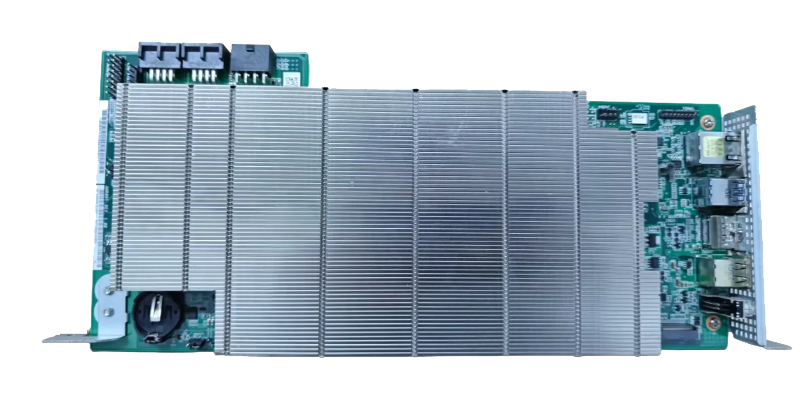
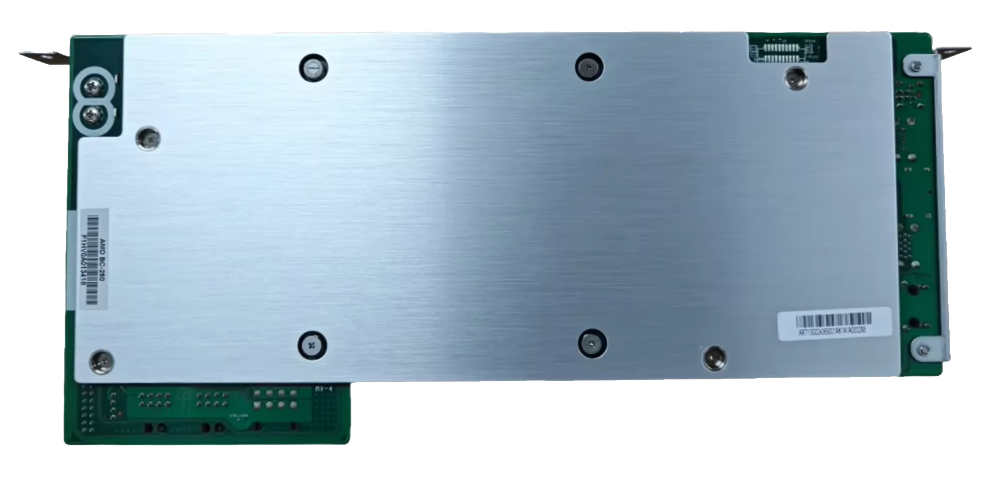
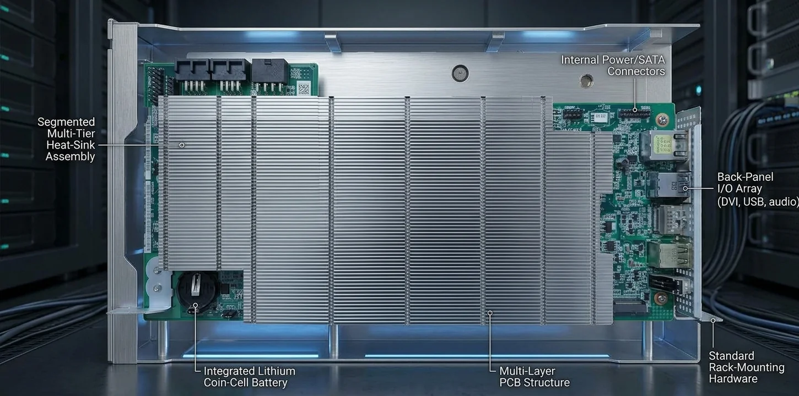
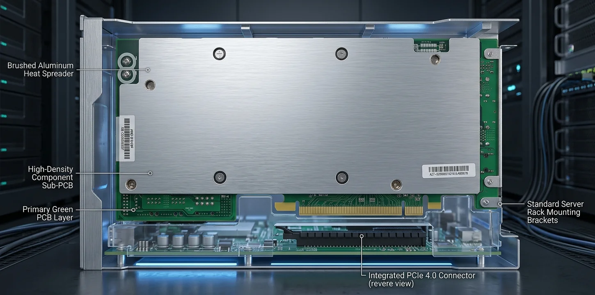

<!-- SPDX-License-Identifier: GPL-3.0-or-later -->

# What is the BC-250?

The BC-250 is a compact computer board built around an AMD processor with Radeon graphics. It can run Linux and
games like a desktop PC. This suite provides tools made specifically for its hardware and for Bazzite.

## Where it comes from

AMD made the BC-250 for cryptocurrency mining, and ASRock Rack built it into a mining system: a 4U rack server with
twelve BC-250 boards side by side, sold as the ASRock 4U12G BC-250. It appeared in early 2022, when mining
Ethereum with graphics chips still paid, and the complete rack with its twelve boards was listed at 13,499 euros
(about 15,000 US dollars at the time). At its reported 610 MH/s, about 50 MH/s per board, mining blogs expected
it to pay itself back in roughly 440 to 530 days.

The processor on the board is a cut-down relative of the PlayStation 5's chip, codenamed *Ariel*: six Zen 2 CPU
cores and an RDNA 2 graphics part with 24 of its compute units switched on, where the PlayStation 5 uses 36.
Reports at the time suggested the boards use console chips that did not pass Sony's tests, with parts disabled;
AMD never confirmed this.

It is sometimes called a Bitcoin-mining board, but it is not a dedicated Bitcoin-mining chip: it combines a
general-purpose CPU with a GPU. GPU-based mining was used for other cryptocurrencies, such as Ethereum, while
Bitcoin mining is dominated by special-purpose hardware.

## How it became a standalone board

In September 2022 Ethereum stopped mining altogether (the switch to proof of stake), and the mining rigs had
nothing left to earn. They were taken apart and the boards sold off on the second-hand market, with no case, no
power supply and no cooling of their own. Sold for a fraction of what they cost new, they caught the attention of
PC enthusiasts as an unusual, low-cost platform for Linux gaming and hardware experiments. Every board on sale today
comes from a dismantled mining rig; none are made new.

The start was not promising. In March 2024 the YouTube channel Craft Computing bought a brand-new rack with its
twelve boards for 699.99 dollars, shipping included, about a twentieth of its listed price two years earlier, and
tried to turn it into a cloud gaming server
([Twelve Node Cloud Gaming Server - AsRock Rack 4U12G BC-250](https://www.youtube.com/watch?v=BRiVjtwkivE)). The
conclusion: with the firmware and drivers of the time, it could not be used for gaming, commercially or otherwise.
That changed as the community took the board apart: modified firmware, Linux drivers that support its graphics, and
tools for unlocking and tuning it, such as this suite, made it the low-cost gaming board it is known as today.

## What is on it

- **Processor:** AMD BC-250 (*Ariel*), 6 Zen 2 cores at up to about 3.5 GHz.
- **Graphics:** RDNA 2 with 24 compute units enabled (codename *cyan-skillfish*).
- **Memory:** 16 GB GDDR6, shared between the processor and the graphics.
- **Ports:** DisplayPort, Gigabit Ethernet, two USB 3.0 and two USB 2.0, and an M.2 2280 slot for an NVMe or SATA
  SSD.
- **Power:** about 220 W, through an 8-pin 12 V PCIe power connector.

Because the boards were built for a server case with its own airflow, a board on its own needs a power supply and
fans on the heat sink; the memory runs hot too. Hardware video encoding and decoding do not work: the firmware for
the video engine is missing.

## The board

The top, with the heat sink, the power connectors and the ports, and the back, with its metal cover. Click a photo
for the large version.

<figure markdown>

<figcaption>Top</figcaption>
</figure>

<figure markdown>

<figcaption>Back</figcaption>
</figure>

The same two sides as illustrations, with the main parts named:

<figure markdown>

<figcaption>Top (illustration)</figcaption>
</figure>

<figure markdown>

<figcaption>Back (illustration)</figcaption>
</figure>

## In motion

A short animation of the board in its case, with sound.

<figure markdown>
<video class="board-video" controls playsinline preload="metadata" poster="../../images/bc250/bc250-clip-poster.webp">
  <source src="../../videos/bc250-clip.mp4" type="video/mp4">
  Your browser cannot play this video; <a href="../../videos/bc250-clip.mp4">download it</a> instead.
</video>
<figcaption>The BC-250 (animation, 8 seconds)</figcaption>
</figure>
