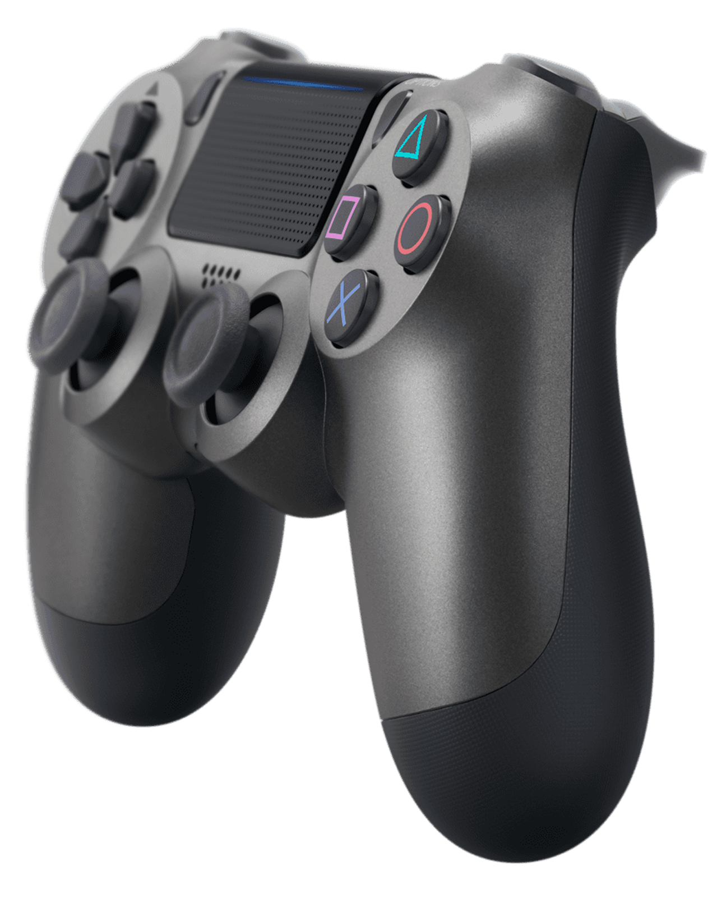
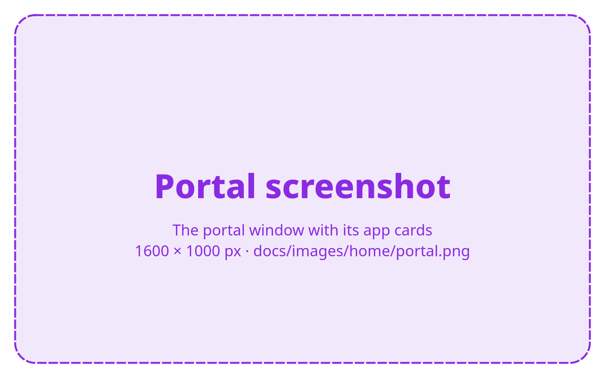

<!-- SPDX-License-Identifier: GPL-3.0-or-later -->

<section class="home-hero" markdown>

{ .home-hero__board }
{ .home-hero__controller }

# Tools for every part of the board. { .home-hero__lead }

Get the most out of your BC-250.

</section>

<section class="home-section home-section--dark" markdown>

## Lots in the suite

#### :material-stethoscope: Diagnostics

[Bazzite Test](apps/bazzite-test.md) checks, stress-tests and benchmarks the board,
[BIOS Reader](apps/bios-reader.md) shows every BIOS setting, hidden menus too, and
[System Overlay](apps/system-overlay.md) keeps CPU, GPU, fan and temperatures on top.

#### :material-speedometer: Tuning

[GPU Governor Manager](apps/governor.md) tunes the GPU governor, [GPU OC Bisect](apps/gpu-oc-bisect.md) finds your
board's safe overclock and undervolt, and [Persistent ACPI](apps/persistent-acpi.md) gives the CPU its C-states and
frequency scaling.

#### :material-lock-open-variant: Unlocks

[CU Bisect](apps/cu-bisect.md) and [Cores Bisect](apps/cores-bisect.md) tell bad CUs and cores apart from an
unstable unlock, and [Memory Manager](apps/memory-manager.md) sets the VRAM split.

#### :material-gamepad-variant: Gaming

[HelixSR Manager](apps/helixsr.md) deploys an FSR 3.1 drop-in upscaler into games, and
[ACE Queues](apps/ace-queues.md) and [Mesh Shaders](apps/mesh-shaders.md) bring async compute and mesh shaders,
beside the system Mesa.

#### :material-gamepad-variant: PlayStation

[shadPS4 Manager](apps/shadps4-manager.md) plays PS4 games with the shadPS4 emulator,
[RPCS3 Manager](apps/rpcs3-manager.md) PS3 games with the RPCS3 emulator, and
[Console Link](apps/console-link.md) finds, wakes and registers PS4 and PS5 consoles for Remote Play.

#### :material-television: Living room

[HDMI CEC Manager](apps/hdmi-cec.md) turns the TV on and off with the board, [SFTP Tools](apps/sftp-tools.md) moves files
between computers, and [Decky Loader Manager](apps/decky-manager.md) adds plugins to Game Mode.

[All the apps](apps/index.md){ .md-button }

</section>

<section class="home-section home-section--light" markdown>

## One portal for every app

The portal installs, opens, updates and removes the apps. Each app is a tile: click its icon to open it, and use
the buttons beside it to install or uninstall. A red dot shows an update. Apps that **change the board** are
marked, and the portal asks before it installs or opens them.

[About the portal](portal.md){ .md-button }

{ .home-split__picture }

</section>

<section class="home-section home-section--accent" markdown>

## Get started

Ready to set up your BC-250? Download the portal from its latest release on the board, check it and run its
installer. It installs BC-250 Bazzite Test with it; every other app installs from the portal.

[:material-download: Download](https://github.com/RobertoTorino/bc250-bazzite-suite/releases/latest){ .md-button .md-button--primary }
[Install steps](install.md){ .md-button }

</section>

<section class="home-section home-faq" markdown>

## FAQ

### Do the apps change my board?

Only the apps marked **changes the board**: the unlocks, the GPU governor, GPU overclocking, the ACPI override, the
VRAM split and the patched GPU drivers. They are software-only and can be undone, and the portal asks before it
installs or opens them. BC-250 Bazzite Test and BIOS Reader only read.

### How do I undo a change?

In the app that made it: each of these apps has an Uninstall, Remove or Undo. Uninstalling an app does not undo
what it changed on the board, so undo that first. [What stays after an uninstall](portal.md#what-stays-after-an-uninstall)
lists each app and how to undo it.

### Do the apps change Bazzite's own driver?

No. ACE Queues and Mesh Shaders build their RADV beside the system Mesa, which stays as it is, and games use it
only when you say so. Bazzite's own packages and their updates are Bazzite's.

### Do I have to install the apps one by one?

No. Install the portal; it installs, updates and removes the apps, each from a tested release that it checks
before it unpacks it. See [Install](install.md).

### Does it work on other boards or systems?

The suite is made and tested for the AMD BC-250 running Bazzite.

### How do I check a download?

Every release comes with a `SHA256SUMS` file: run `sha256sum --check --ignore-missing SHA256SUMS` before you
install. See the [security policy](SECURITY.md#verifying-a-download).

### Is it open source?

Yes. The code of every app is on [GitHub](https://github.com/RobertoTorino/bc250-bazzite-suite), under the licenses
below.

### Where do I get help?

Open an issue on [GitHub](https://github.com/RobertoTorino/bc250-bazzite-suite/issues). For a security problem,
use **Security → Report a vulnerability** instead, as the [security policy](SECURITY.md) says.

## License

GPL-3.0-or-later, except BC-250 Persistent ACPI, which is MIT, Console Link, which is AGPL-3.0 (its
protocol code comes from chiaki-ng), and Bazzite NetcatGUI, which is GPL-2.0 (a port of NetcatGUI). Each app has
its own `LICENSE`.

</section>
